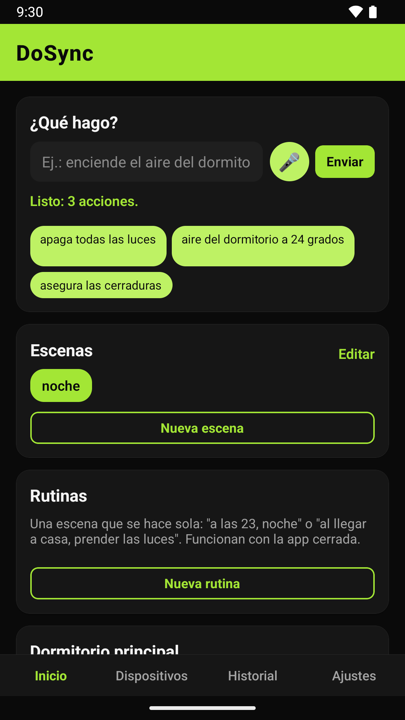
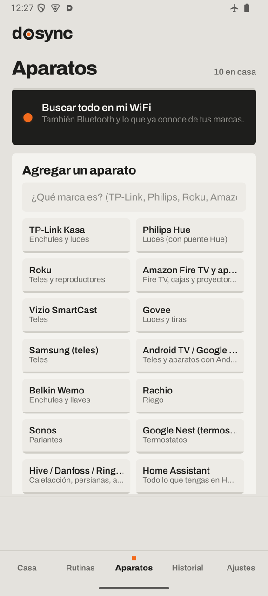
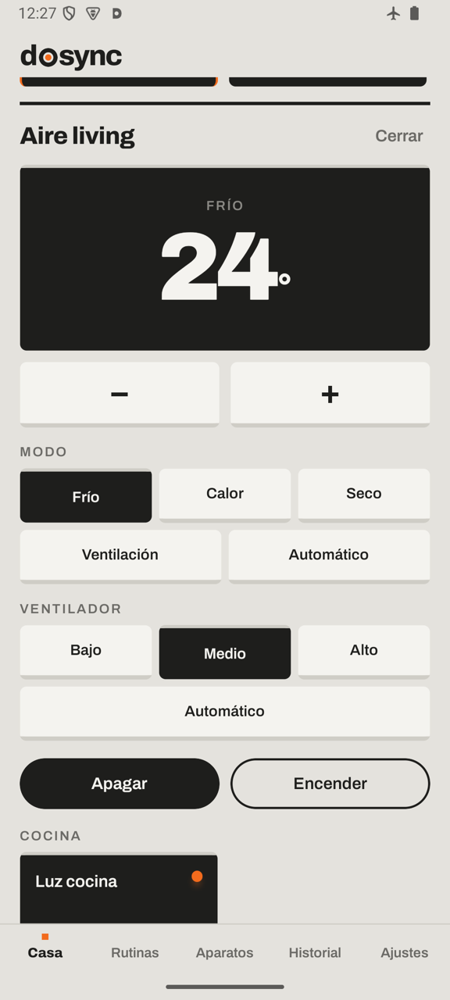
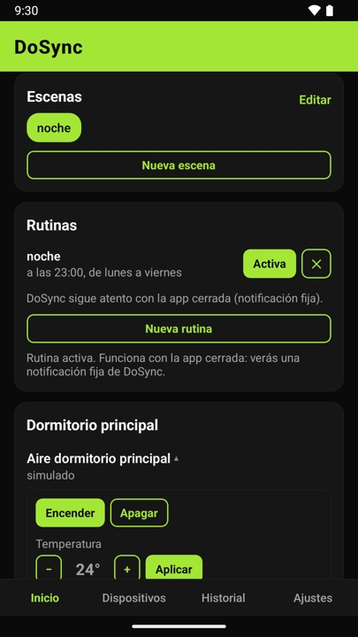
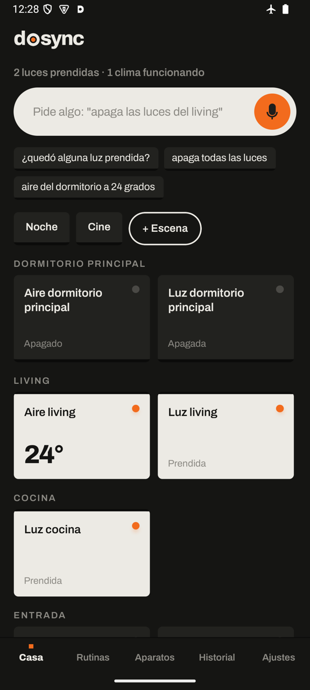

# DoSync App · open beta

**English** · [Español](README.md)

> 🧪 **This is a beta.** The app already works in real homes, but we are still
> testing it with many brands and devices. Expect rough edges; some brands are
> tested only against simulators. **Your feedback helps a lot**: what worked, what
> didn't, and what you'd like it to do.

DoSync is a free Android app that runs your home in your own words: *"turn off all
the lights"*, *"set the bedroom AC to 24"*, *"put the latest video from that channel
on the TV"*. **Your phone is the hub**: no extra device to buy, no account of ours.

<p>





</p>

## Download

| Where | Status |
|---|---|
| **GitHub** (this repository) | [Latest version ↓](../../releases/latest): download `DoSync-x.y.z.apk` and open it on your Android phone (8.0 or newer). The app tells you when a new version is out. |
| **Google Play** (closed test) | Three steps, with your phone's Google account: 1) [join the testers group](https://groups.google.com/g/dosync_testers), 2) [accept the test](https://play.google.com/apps/testing/dev.dosync.app), 3) [install it from Google Play](https://play.google.com/store/apps/details?id=dev.dosync.app). It updates itself and includes **Samuel**, DoSync's AI by subscription. |

If you later install DoSync from Google Play, uninstall the GitHub one first: they
are signed differently and don't update each other.

## What it does

- **Finds** what's on your Wi-Fi and Bluetooth and adds it with one tap.
- **Understands commands in 6 languages** (English, Spanish, Portuguese, French,
  German and Italian) on the phone, free, without AI.
- **With AI (optional)**, your own (Claude, Gemini or ChatGPT) or on-device Gemini
  Nano: searches the web, chains steps, schedules timers and rules, creates scenes.
- **Or free AI on your own computer**, with [Ollama](https://ollama.com) or LM Studio:
  no key, no cost, and your commands never leave your home. The app finds it on your
  Wi-Fi and picks the model (recommended: `qwen3`). In Ollama, turn on
  *Settings → Expose Ollama to the network*. While the computer is on, everything
  works except web search.
- **Several homes** (yours, the beach house) and **family invited** with a one-time, encrypted code.
- **Scenes and routines** that run with the app closed.
- **Infrared control** with the phone's IR blaster or a Broadlink.
- **Sensitive actions wait for your confirmation**: unlocking a door, opening a
  gate, turning on an oven.

Works with thousands of devices, and more brands keep coming: Philips Hue and WiZ, TP-Link, Shelly, Tuya, IKEA, Samsung,
LG, Android TV, Fire TV, Roku, Sonos, tado°, Nest, Netatmo, Bosch, Homematic, Miele,
Home Connect, Nuki, Somfy, Home Assistant and many more.

### Custom OpenAI-compatible providers (protocol hub)

The [open DoSync protocol](https://dosync.dev) reference hub includes an
[LLM resolver](https://github.com/giulianireg-spec/dosync-protocol/blob/main/llm_resolver.py)
that works with **any server implementing `POST /v1/chat/completions`**: Ollama,
LM Studio, llama.cpp, vLLM, LocalAI, OpenAI, Mistral and others. Point it at your
provider with a base URL, a model name and (if needed) an API key:

```bash
LLM_BASE_URL=https://api.example.com/v1 LLM_MODEL=my-model LLM_API_KEY=... \
  python3 llm_resolver.py
```

See the [resolver docs](https://github.com/giulianireg-spec/dosync-protocol/blob/main/docs/LLM-RESOLVER.md).
This describes the protocol's hub, not the Android app's built-in AI settings.

## Feedback

[Share your experience](../../issues/new?template=opinion.yml) ·
[Report a bug](../../issues/new?template=error.yml) ·
[Request a brand](../../issues/new?template=marca.yml) · giulianireg@gmail.com

## Privacy

Your data stays on your phone: DoSync has no servers that receive it.
[Privacy policy](https://giulianireg-spec.github.io/dosync-adapters/privacy/).

## About this repository

This repository hosts the downloadable versions, release notes and feedback. The
app's source code is not public. DoSync App is built on the
[open DoSync protocol](https://dosync.dev).

Free to use under the [license](LICENSE). © 2026 Rodrigo Giuliani.
